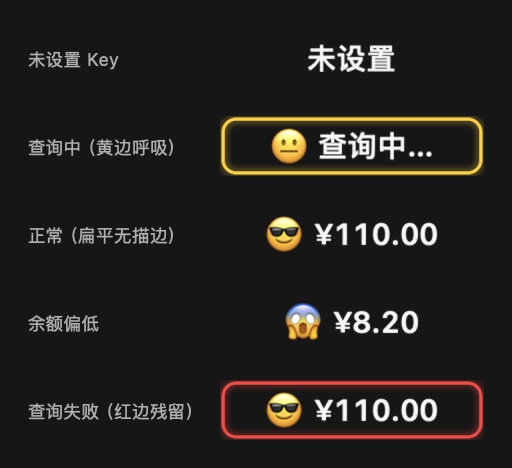

# DeepSeek 余额 · Pock 组件

在 MacBook 的 Touch Bar 上显示你的 DeepSeek API 账户余额。点击数字手动刷新，默认每 5 分钟自动刷新一次。

基于 [Pock](https://github.com/pock/pock)（Touch Bar 组件管理器）。



---

## 效果

| 状态 | 表现 |
|---|---|
| 正常 | 只有「表情 + 余额」，扁平无框，比如 `😎 ¥110.00` |
| 查询中 | 一圈黄色边缘光持续呼吸 |
| 查询成功 | 边缘光闪绿色两次，然后消失回到干净状态 |
| 查询失败 | 边缘光闪红色两次，留下一道很淡的红边，提醒这个数字可能已经过期 |

余额前面的表情可以自己配置，按余额区间切换，默认五档：

```
余额 ≥ 0    → 😱
余额 ≥ 5    → 😐
余额 ≥ 20   → 🙂
余额 ≥ 60   → 😎
余额 ≥ 200  → 🤩
```

---

## 安装

需要 **macOS 11+、带 Touch Bar 的 Mac**，以及 **Pock 0.9.0**（[官网下载](https://pock.app) / [GitHub Releases](https://github.com/pock/pock/releases)）。

### 方式一：直接用（推荐）

```bash
git clone https://github.com/zhoujingwei136/pock-deepseek-balance.git
cp -R pock-deepseek-balance/DeepSeekBalance.pock \
      ~/Library/Application\ Support/Pock/Widgets/
pkill -x Pock; open -a /Applications/Pock.app
```

不想用命令行的话，把仓库下载下来，在访达里按 `⌘⇧G` 跳转到
`~/Library/Application Support/Pock/Widgets/`，把 `DeepSeekBalance.pock` 拖进去，然后重启 Pock。

### 方式二：用 Pock 自带的安装器

点菜单栏的 Pock 图标 →「**安装部件…**」→ 选择 `DeepSeekBalance.pock`。

### 方式三：自己编译

只需要 Command Line Tools（`xcode-select --install`），**不需要 Xcode、CocoaPods 或 ibtool**。

```bash
./build.sh              # 编译出 DeepSeekBalance.pock
./build.sh --install    # 编译并直接安装
```

首次运行会自动拉取并编译依赖（PockKit 0.2.0 + SnapKit），大约半分钟。

> 国内访问 GitHub 不稳定时脚本会自动重试 5 次；仍然失败的话可以换镜像：
>
> ```bash
> SNAPKIT_REPO=https://<镜像>/SnapKit/SnapKit.git \
> POCKKIT_REPO=https://<镜像>/pock/pockkit.git ./build.sh
> ```
>
> 只是使用、不打算改代码的话，直接复制仓库里预构建好的 `DeepSeekBalance.pock` 就行，不必编译。

---

## 使用

1. 点菜单栏的 Pock 图标 →「**管理部件…**」
2. 左侧列表选「**DeepSeek 余额**」
3. 填入 API Key → 点「**保存并查询**」，面板会立刻告诉你结果
   - 没有 Key 的话，点旁边的「获取 API Key」直接去 DeepSeek 平台创建
4. 再点「**自定义 Pock…**」→ 把「DeepSeek 余额」拖到触控栏上

之后**点一下数字就手动刷新**。

### 配置表情区间

在同一个偏好面板里，可以增删改「余额达到多少 → 显示哪个表情」的对应关系：

```
☑ 在余额前显示表情
  余额 ≥ [0  ] → [😱] [移除]
  余额 ≥ [5  ] → [😐] [移除]
  余额 ≥ [20 ] → [🙂] [移除]
  余额 ≥ [60 ] → [😎] [移除]
  余额 ≥ [200] → [🤩] [移除]
  [＋ 添加一档]  [恢复默认区间]
```

低于最低档时用最低档的表情。表情也可以整体关掉。

---

## 说明

- 余额来自 `GET https://api.deepseek.com/user/balance`，官方文档见
  [查询余额](https://api-docs.deepseek.com/zh-cn/api/get-user-balance/)
- **API Key 以明文保存在本机**：`~/Library/Preferences/com.zhoujingwei.pock.DeepSeekBalance.plist`，
  只用于请求 `api.deepseek.com`，不会发往别处。共享电脑上请注意。
- 自动刷新每 5 分钟一次，可以在面板里关掉；组件被移出触控栏时定时器会自动停止，不会后台空转。
- 查询失败时会**保留上一次的余额**，只用红边提示这次没查成功，不会让数字凭空消失。

## 实现说明

几个不太显然的点，写下来给需要改代码的人：

- Pock 内置的 `PockKit.framework` 被剥掉了 `Modules` 目录，无法直接 `import`，
  所以 `build.sh` 会从源码编译一份**版本对齐（0.2.0）**的模块用于编译期，
  运行时则通过 rpath 复用 Pock 自带的那份，保证协议对象是同一个。
- 组件协议的名字必须用 `@objc(PKWidget)` 精确匹配。Swift 默认会给协议名加上模块前缀
  （`DeepSeekBalance.PKWidget`），那样运行时不会和 PockKit 的 `PKWidget` 认成同一个协议，
  组件会被静默忽略。
- 偏好面板没有 nib。Pock 用 `init(nibName:bundle:)` 实例化面板，但 nib 只在默认的
  `loadView()` 里才会被加载——重写 `loadView()` 用代码搭界面，就不需要 nib 了
  （也就绕开了只在 Xcode 里才有的 `ibtool`）。
- 表情和数字都是**渲染成位图后按墨迹（不透明像素范围）定位**的，没有用 `NSTextField`。
  因为 `NSTextFieldCell` 的内边距左右不对称（会把最后一个字符切掉），而且它只保证文本框居中、
  不保证字形墨迹居中；emoji 字形 18pt、数字只有 12pt，放在一起会明显差半个点以上。

## 许可

[MIT](LICENSE)。与 Pock 官方无关，是第三方组件。
